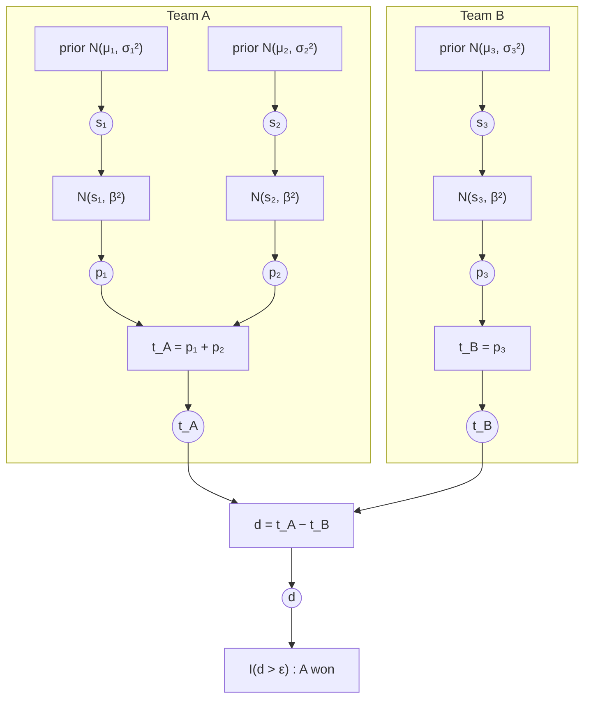
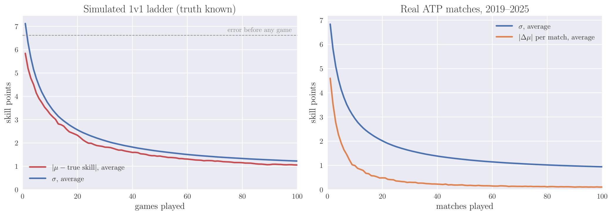

# skillgraph

Bayesian skill ratings in Python, built on an expectation-propagation engine.
TrueSkill 1 is complete; TrueSkill 2 is in progress.

> TrueSkill is a trademark of Microsoft. This project is independent and not
> affiliated with or endorsed by Microsoft.

## Quickstart

```python
import skillgraph as sg
from skillgraph import Match, Rating

alice, bob = sg.rate_1vs1(Rating(), Rating())          # alice won
# Rating(mu=29.396, sigma=7.171), Rating(mu=20.604, sigma=7.171)

env = sg.TS1(beta=4.0, draw_probability=0.25)          # custom settings
red, blue = [Rating(), Rating()], [Rating(), Rating()]
red, blue = env.rate([red, blue], ranks=[1, 0], partial_play=[[1, 0.5], [1, 1]], match_weight=0.8)

sg.quality([red, blue])                        # 0..1, higher = more balanced
sg.win_probabilities([red, blue, [alice]])     # P(each team finishes first)
sg.outcome_probability([red, blue], [0, 0])    # P(this exact result), e.g. for log-loss
alice.conservative()                           # mu - 3*sigma, for leaderboards

result = sg.rate_matches(
    [Match([["ann", "ben"], ["cat", "dan"]], ranks=[0, 1]), Match([["ann"], ["cat"]], ranks=[0, 0])],
    with_probabilities=True,
)
result.ratings["ann"], result.probabilities
```

Top-level functions use TrueSkill 1 with default settings, same as `sg.TS1.rate(...)`.

## The model

A player's skill is a Gaussian belief, $s_i \sim \mathcal N(\mu_i, \sigma_i^2)$. In a match each player
performs at $p_i \sim \mathcal N(s_i, \beta^2)$, a team's performance is the sum of its players', and
the better-performing team wins unless the gap is inside the draw margin $\varepsilon$:

$$
t_A=\sum_{i\in A} p_i,\qquad d=t_A-t_B,\qquad
\text{A wins} \iff d>\varepsilon,\qquad \text{draw} \iff |d|\le\varepsilon .
$$

Every match is this factor graph (circles are variables, boxes are factors); here team A, two players,
beat team B, one player:



Rating a match means computing each $s_i$'s posterior. Messages flow down from the priors to the
outcome and back up. Everything is Gaussian except the outcome factor at the bottom, which is handled
by moment matching (expectation propagation). With two teams one pass is exact; with more teams the
engine iterates over the chain of differences until it converges. The posterior $\mu_i$, $\sigma_i$
become the player's new rating.

## How fast do ratings converge?



Left: a simulated 1v1 ladder where true skills are known. With default settings $\sigma$ falls from
8.3 to 3.6 after 10 games, 2.3 after 25 and 1.2 after 100, and the actual error in $\mu$ tracks it
closely, which is what a calibrated uncertainty should do. Right: the same quantities on seven seasons
of real ATP matches: the typical rating change per match shrinks from 4.6 points on debut to about 1
point after 10 matches and 0.1 after 100. With skill drift $\tau>0$ the uncertainty never reaches zero;
it settles where drift and evidence balance.

## Accuracy and robustness

Every result is checked against independent implementations of the same model: 80-digit
arbitrary-precision math, a textbook closed form, a separately written matrix-based EP, and Monte Carlo
sampling of the exact posterior. Compared with existing implementations:

| Problem | Here |
|---|---|
| Crashes on extreme upsets | Stable at $10^{12}$-sd upsets |
| Textbook `1 - w` cancels: variance errors of 100% (big upsets) to $3\times10^6$ (tiny draw rates) | Regime-specific formulas, $\le 2\times10^{-10}$ relative |
| Odd ratings in large free-for-alls | Matches an independent dense EP to $10^{-12}$ at 100+ players |
| Cavities from subtracting large precisions (negative variances) | Products of the other messages; no Gaussian division |
| EP oscillation on contradictory results | Damping fallback; warns only beyond $10^6$-sd gaps, still returns valid ratings |
| Results drift between versions | Golden-file regression test, 300 cases |
| Win probability for two teams only | `win_probabilities` (any number of teams), `outcome_probability` (incl. draws) |

Guarantees enforced by the tests: two teams exact (closed form, $10^{-10}$ vs arbitrary precision);
three or more teams within $10^{-8}$ of a converged independent EP and about $0.05\sigma$ of the exact
posterior; `win_probabilities` exact to $10^{-15}$ up to 25 teams; `outcome_probability` exact for two
teams and $\sim10^{-7}$ absolute for 3–12 teams. Throughput on one core: ~79k 1v1 updates/s,
~33k 5v5/s, ~850 8-player free-for-alls/s.

## Limitations

- Sigmas are slightly overconfident: about 60% of true skills fall within $1\sigma$ (ideal 68%);
  $2\sigma$ coverage is about 95%. TrueSkill 1 rates one match at a time and ignores correlations
  between players.
- Results depend on the order matches are processed, by design.
- With three or more teams, ties among more than two teams depend on input order (only consecutive
  finishers are compared).
- The defaults were set for video games. Tune `beta`, `tau` and `draw_probability` on your data
  (see the tennis notebook).
- Only skill *differences* are identified by results; the overall level stays anchored to the prior.

## Examples

- `examples/atp_tennis.ipynb`: seven seasons of real ATP tennis, with parameter tuning, an out-of-sample
  test against Elo and the official ranking, and surface-specific ratings.
- `examples/skillgraph_tour.ipynb`: a guided tour on simulated data.

## Development

```bash
pip install -e ".[dev]"
pytest                   # full suite (~1 min)
pytest -m "not slow"     # quick run (~10 s)
SKILLGRAPH_STRESS=1 pytest   # ~10x more random cases
ruff check . && mypy
```
