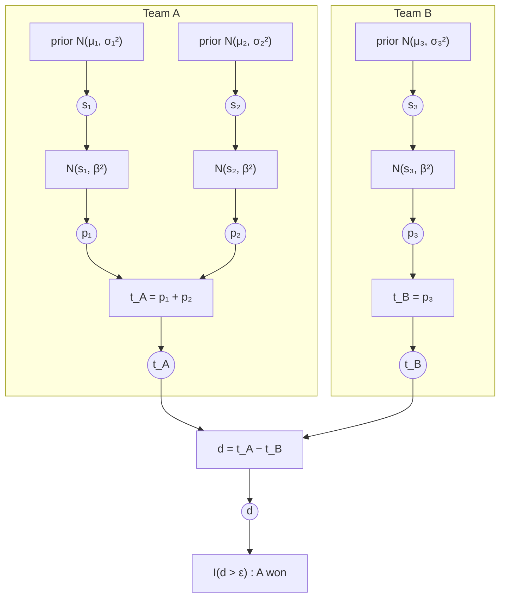

# skillgraph

Bayesian skill ratings in Python, built on an expectation-propagation engine.
TrueSkill 1 is complete; TrueSkill 2 is in progress (see `ROADMAP.md`).

> TrueSkill is a trademark of Microsoft. This project is independent and not
> affiliated with or endorsed by Microsoft.

## Quickstart

```python
import skillgraph as sg
from skillgraph import Match, Rating

alice, bob = sg.rate_1vs1(Rating(), Rating())          # alice won
# Rating(mu=29.396, sigma=7.171), Rating(mu=20.604, sigma=7.171)

env = sg.TS1(beta=4.0, draw_probability=0.25)          # custom settings
red, blue = [Rating(), Rating()], [Rating(), Rating()]
red, blue = env.rate([red, blue], ranks=[1, 0], partial_play=[[1, 0.5], [1, 1]], match_weight=0.8)

sg.quality([red, blue])                        # 0..1, higher = more balanced
sg.win_probabilities([red, blue, [alice]])     # P(each team finishes first)
sg.outcome_probability([red, blue], [0, 0])    # P(this exact result), e.g. for log-loss
alice.conservative()                           # mu - 3*sigma, for leaderboards

result = sg.rate_matches(
    [Match([["ann", "ben"], ["cat", "dan"]], ranks=[0, 1]), Match([["ann"], ["cat"]], ranks=[0, 0])],
    with_probabilities=True,
)
result.ratings["ann"], result.probabilities
```

Top-level functions use TrueSkill 1 with default settings, same as `sg.TS1.rate(...)`.

## The model

A player's skill is a Gaussian belief, $s_i \sim \mathcal N(\mu_i, \sigma_i^2)$. In a match each player
performs at $p_i \sim \mathcal N(s_i, \beta^2)$, a team's performance is the sum of its players', and
the better-performing team wins unless the gap is inside the draw margin $\varepsilon$:

$$
t_A=\sum_{i\in A} p_i,\qquad d=t_A-t_B,\qquad
\text{A wins} \iff d>\varepsilon,\qquad \text{draw} \iff |d|\le\varepsilon .
$$

Every match is this factor graph (circles are variables, boxes are factors); here team A, two players,
beat team B, one player:



Rating a match means computing each $s_i$'s posterior. Messages flow down from the priors to the
outcome and back up. Everything is Gaussian except the outcome factor at the bottom, which is handled
by moment matching (expectation propagation). With two teams one pass is exact; with more teams the
engine iterates over the chain of differences until it converges. The posterior $\mu_i$, $\sigma_i$
become the player's new rating.

## Examples

- `examples/atp_tennis.ipynb`: seven seasons of real ATP tennis, with parameter tuning, an out-of-sample
  test against Elo and the official ranking, and surface-specific ratings.
- `examples/skillgraph_tour.ipynb`: a guided tour on simulated data.

Accuracy guarantees, fixes relative to other implementations, and known limitations: `docs/ts1.md`.

## Development

```bash
pip install -e ".[dev]"
pytest                   # full suite (~1 min)
pytest -m "not slow"     # quick run (~10 s)
SKILLGRAPH_STRESS=1 pytest   # ~10x more random cases
ruff check . && mypy
```
